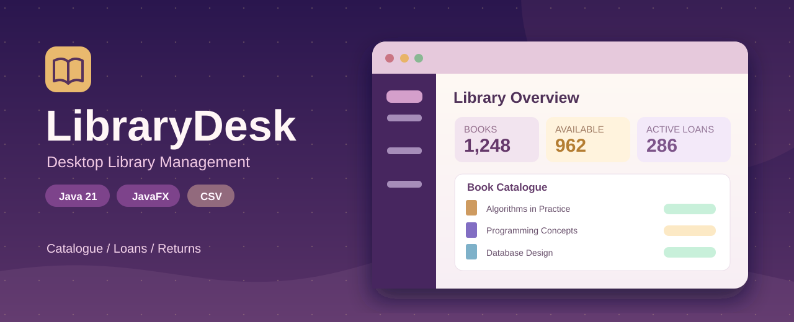
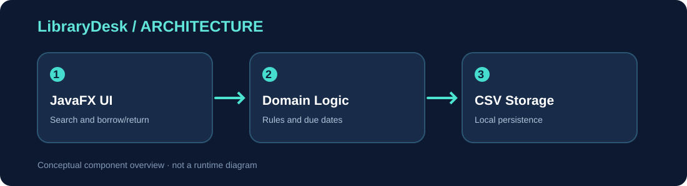

<p align="center"></p>
<p align="center"><strong>Offline desktop library management</strong></p>
<p align="center"><code>Java 21 · JavaFX · CSV</code></p>

> **Portfolio learning project / AI-assisted starter.** This project demonstrates skills under development; tests and deployment limits are disclosed below. All examples are fictional.

**Project tour:** [Features](#features) · [Architecture](#architecture-at-a-glance) · [Run locally](#run-the-desktop-application) · [Testing and limitations](#verification-status)

## Architecture at a glance



## Verification status

Java domain and CSV tests passed; JavaFX UI launch not verified. These checks do not certify the app as production-ready.

# LibraryDesk — Java + JavaFX Desktop Application


An offline desktop library-management prototype with a clean **JavaFX** interface and a tested Java domain layer. Manage a fictional book catalogue, loans, return dates and overdue items. Designed for a programming portfolio.

## Features

- Filter the catalogue by title, author, category or ID
- Add/remove books with validation
- Borrow books for a fixed 14-day period; return and track overdue loans
- Summary dashboard showing books, available copies, active loans and overdue items
- Persist books and loan history to **CSV files** in the user's home directory
- Sample books loaded on first run; no network calls or credentials required
- Pure Java domain and persistence self-tests

## Run the desktop application

Requirements: **JDK 21** and **Apache Maven**. Maven downloads the matching JavaFX SDK for your computer.

```bash
mvn javafx:run
```

All application data is stored locally in `~/.library-desk-portfolio/` (and can be deleted to reset the demo).

## Verify business logic without JavaFX

If Java 21 is installed on macOS/Linux:

```bash
bash scripts/test-domain.sh
```

Or on Windows compile the 4 domain files in `src/main/java/com/portfolio/library/` and `src/test/java/com/portfolio/library/LibrarySelfTest.java`, then run the self-test with `java -ea`.

**Testing status:** Domain logic and CSV persistence were compiled and tested on Java 21. The JavaFX UI was not launched in the build environment because Maven/JavaFX dependencies are not preinstalled. Please run `mvn javafx:run` on your own computer to check rendering and interaction.

## Architecture

| Class | Responsibility |
|---|---|
| `Book` / `Loan` | Validated immutable records |
| `Library` | Borrow/return rules, searching and overdue logic |
| `CsvStore` | Local persistence and data reload |
| `LibraryApp` | JavaFX UI and forms |

The prototype uses fictional examples; it is not a complete production circulation system. It does not implement user authentication, fines, multi-user locking or external database synchronization.

## License

MIT; see LICENSE.

## Portfolio attribution / next steps

This project began as an **AI-assisted portfolio starter**. Before adding it to an academic application, review the code, run the app, make improvements you understand, and describe your actual role accurately. Do not present generated code as entirely hand-written or portray fictional demonstration data as real records.
